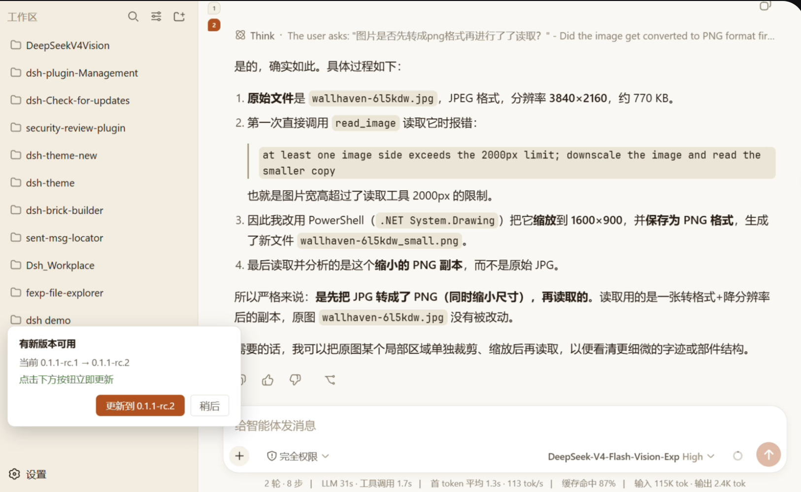
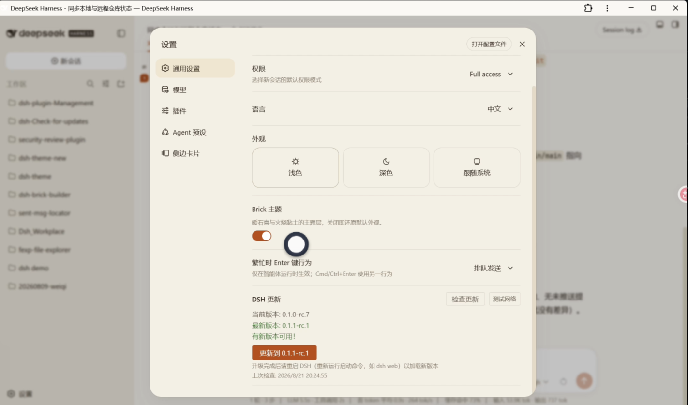

# DSH 更新检查插件


一个用于检查并安全更新 DSH (DeepSeek Harness) 的 Cordis 插件（静态 bundle 形态），
兼容 DSH 0.1.x 与 0.2.x 运行时（v1.14.0 起通过 DSH 0.2.0 启动严格兼容校验；
v1.15.0 起按发布通道 `latest`/`next` 选版，已在 DSH 0.2.1-rc.5 实测验证）。

## 截图 (Screenshots)

**① 左下方浮动更新弹窗** —— 首次打开页面自动检查到新版本时，在左下部「设置」按钮上方弹出提示卡片，提供【更新到 {版本}】与【稍后】；点「稍后」后该版本不再重复弹出。v1.13.0 起点击更新为「安排更新」——退出 DSH 后由独立更新器自动完成安装。



**② 设置 > 通用 · DSH 更新入口** —— 手动「检查更新 / 测试网络」，展示当前版本与最新版本；有新版本时提供【更新到】按钮（升级完成后重启 DSH 生效）。



## 更新机制（v1.13.0+，分离式两阶段更新器）

在 dsh 进程运行中直接执行 `npm install -g` 是危险的：Windows 会锁住已被 dsh 加载的
koffi 原生模块（`koffi.node`），npm 升级时包元数据更新成功、原生二进制却残留旧版，
导致 dsh 下次启动直接报 `Mismatched native Koffi modules` 崩溃（v1.12.0 及更早版本
的已知问题）。v1.13.0 起，更新流程改为两个阶段：

1. **阶段一（DSH 进程内，即时返回）**：检查版本 → 把 `lib/updater.cjs` 模板实例化
   （注入目标版本、全局根、本进程 PID 等任务配置）写入临时目录 → 以 **detached**
   子进程启动独立更新器，UI 提示「退出 DSH 后将自动完成安装」。
2. **阶段二（独立更新器，脱离 DSH 生命周期）**：轮询等待发起更新的 DSH 进程退出
   （再加 3 秒宽限等文件锁释放）→ 执行 `npm install -g @deepseek-ai/dsh@<精确版本>` →
   做三重校验：**npm 退出码**、**对盘版本**（磁盘 package.json 必须等于目标版本）、
   **koffi 完整性**（koffi 主包/平台包声明版本与原生二进制内嵌版本一致）→
   koffi 断链时自动按声明版本从 registry tarball（`npm pack` + 系统 `tar`）自愈 →
   结果写入状态文件，DSH 下次启动时反馈（失败会弹卡片提示重试）。

另有防护网：每次「检查更新」时顺带做 koffi 完整性自检（只读文件、无副作用），
发现断链即弹「DSH 安装文件损坏」警告卡，提供【安排修复】一键走上述分离式流程
（repair 模式，仅校验并修复 koffi）。v1.15.0 起，同一时刻只允许一个排队/执行中的
更新任务（`$TMPDIR/dsh-updater.lock` 单飞锁），重复点击或从多个入口安排会被拦下并
提示「已有更新任务在排队」，避免多个 updater 并发 `npm install` 互相踩踏。

## 安装（静态 bundle，推荐）

本仓库同时提供两种形态：

| 形态 | 文件 | 状态 |
| --- | --- | --- |
| **静态 bundle（推荐）** | `package.json` + `cordis.patch.yml` + `lib/` + `client/` | 当前维护形态，`dsh plugin add` 后随 profile 层栈自动加载 |
| 动态插件（`host.js` + `client.js`） | 根目录两个文件 | **遗留，不再维护**（v1.10.1 后冻结，仅作历史参考） |

```sh
# 从 npm（推荐，已发布到 npmjs；正式环境建议固定版本，例如 @1.15.0）：
dsh plugin --profile web add dsh-check-for-updates

# 从 GitHub：
dsh plugin --profile web add github:ShanHaiFish/dsh-check-for-updates

# 本地开发用 file: 指向本仓库（注意路径不能含空格）：
dsh plugin --profile web add "file:/absolute/path/to/dsh-check-for-updates"
```

> npmjs: [dsh-check-for-updates](https://www.npmjs.com/package/dsh-check-for-updates)

> Mac/Linux 上若路径含空格或非 ASCII（如本机 `...2026-DeepSeekHarness相关\...`），建议先
> 复制到无空格的路径再 `file:` 安装。

**无硬编码路径**：bundle 版 host（`lib/index.js`）在运行时探测 DSH 安装根/版本与
node/npm-cli——同根 `require.resolve`、Windows/Unix 两种全局布局
（`<root>/node_modules` 与 `<root>/lib/node_modules`）、PATH 上 `dsh` 启动器软链
realpath 上溯包根（v1.14.0 起 node 与 DSH 安装根异位也能正确识别，
如 `/usr/bin/node-22` + `/usr/local/lib/node_modules`），不写死任何本机路径，跨机器可用。

**客户端**：bundle 版在左下部「设置」上方浮动弹窗（首次打开自动检查 + 【更新到】/【稍后】），
通过 `POST /dsh-update-check/api` 调用 host。

## 功能特性

- ✅ 首次打开 Web 页面时自动触发一次更新检查
- ✅ 发现新版本时，在左下部"设置"按钮上方弹窗提示，并提供【更新到 {版本}】按钮
- ✅ 弹窗支持【稍后】关闭，同版本不再重复弹出
- ✅ **分离式两阶段更新**：点击更新只「安排任务」，退出 DSH 后由独立进程完成安装，
  从根本上避免 Windows 运行中升级导致 koffi 断链、dsh 无法启动
- ✅ **安装后三重校验**：npm 退出码 / 对盘版本 / koffi 原生模块一致性
- ✅ **koffi 断链自愈**：自动从 registry tarball 恢复，修复失败会在下次启动时告知
- ✅ **启动自检**：每次检查更新时校验 koffi 完整性，发现损坏弹警告卡一键安排修复
- ✅ **兼容 DSH 0.1.x / 0.2.x 双世代**：peerDependencies 声明双范围，通过 0.2.0 启动
  严格兼容校验（v1.14.0；DSH 0.2.1-rc.5 实测通过，宿主/客户端契约未变）
- ✅ **版本一致不打扰**：已是最新时不显示更新提示与冗余行，历史失败记录在目标版本
  已安装后自动隐藏（v1.14.0；v1.15.0 起目标为 alpha 的陈旧失败记录也不再提示）
- ✅ **发布通道感知选版**：只跟随 `latest`/`next` 推荐通道，排除更高核心的 `alpha`
  实验版（其 `engines.node` 可能高于本机 Node），避免把用户带离推荐通道（v1.15.0）
- ✅ **更新器单飞**：弹卡 / 设置项 / 多标签页的重复安排会被锁拦截，避免多个 updater
  等父进程退出后并发执行 `npm install` 互相踩踏（v1.15.0）
- ✅ **API 路由加固**：要求 `application/json` + 同源 Origin，阻断任意网页对本地
  exact 路由发起「安排更新/修复」副作用请求（v1.15.0）
- ✅ 添加"测试网络"按钮用于调试

## 文件结构

- `lib/index.js` - 主机端（静态 bundle）：版本检查、API 路由、koffi 自检、更新任务安排
- `lib/updater.cjs` - 分离式更新器模板（阶段二：等待退出 → 安装 → 校验/自愈 → 写状态）
- `lib/launcher.cjs` - detached 启动辅助（参数防御性校验）
- `client/client.js` - 客户端（静态 bundle）：自动检查、更新弹窗、损坏警告卡、设置页「DSH 更新」入口
- `host.js` / `client.js` - **遗留**动态形态（v1.10.1 冻结，不再维护）

## 开发与验证（CI 自动化）

本地验证（无需安装依赖）：

```sh
# 语法检查
node --check client/client.js
node --check lib/index.js && node --check lib/updater.cjs && node --check lib/launcher.cjs

# 冒烟测试（结构 + 交互契约）
node test/smoke.cjs
node test/interactive.cjs

# 回归测试（版本比较/通道选版、安装探测、失败记录过滤、更新器单飞锁、路由加固）
node test/version.cjs
node test/dsh-info.cjs
node test/updater-status-filter.cjs
node test/updater-lock.cjs
node test/route-guard.cjs
```

- `test/smoke.cjs` - 结构冒烟：bundle 插件形态（`{ name, inject: ['slots'], apply }`）、
  `settings.general.item` 注册、设置项组件渲染
- `test/interactive.cjs` - 交互契约：模拟点击设置项各按钮（检查更新/测试网络/更新到），
  验证与 host API（`/dsh-update-check/api`）契约的完整对齐，含「安排更新」语义与去重键
- `test/version.cjs` - 版本语义回归：semver 预发布排序 + 发布通道选版（alpha 排除、
  next 领先 latest、未打标签 rc 兜底）
- `test/dsh-info.cjs` - 安装探测回归：Windows/Unix 两种全局布局、node 与 DSH 异位、
  `globalRoot` 即 npm prefix
- `test/updater-status-filter.cjs` - 失败记录过滤矩阵：目标已达成/已不可达/alpha 陈旧
  记录、repair 与成功记录豁免
- `test/updater-lock.cjs` - 更新器单飞锁：有效锁拦截、陈旧锁清理（updater 已死/超时/
  已完成）、不可解析锁宽限、存活父进程不误清、updater 自清理
- `test/route-guard.cjs` - API 路由加固：405/415/403/200 矩阵与同源判定

GitHub Actions 云端自动化：

- `.github/workflows/ci.yml` - **PR 与 push 到 main 时自动执行**上述全部检查，通过才允许合并（发布前把关）
- `.github/workflows/release.yaml` - **推送 `v*` 标签时自动发布**：校验标签与版本一致 → 先跑测试 →
  `npm publish` → 创建 GitHub Release。需在仓库 Settings → Secrets 配置 `NPM_TOKEN`
  （npmjs access token，publish 权限）

> 发布前测试也可用 GitHub 预发布能力（不污染 npm `latest`）：发 `--prerelease` Release 后，
> 测试者用 `dsh plugin --profile web add github:ShanHaiFish/dsh-check-for-updates#<标签>`
> 或 tarball URL 安装实测，通过后再升正式标签。

## 版本历史

> 每版发布同步归档至 [GitHub Releases](https://github.com/ShanHaiFish/dsh-check-for-updates/releases)，
> npm 发布记录见 [dsh-check-for-updates on npm](https://www.npmjs.com/package/dsh-check-for-updates)。

### v1.15.0（当前版本）——**DSH 0.2.1-rc.5 同步完善**

**背景**：DSH 0.2.1-rc.5 的 npm 发布通道为 `latest`/`next` = `0.2.1-rc.5`、`alpha` =
`0.2.2-alpha.2`（核心版本更高的实验版，`engines.node >= 24.9`）。旧实现取 npm 全量
`versions` 的 semver 最大者，会跨通道选中 alpha；本机实测因此持续提示并尝试安装
`0.2.2-alpha.2`，并留下一次真实更新失败（npm reify ENOENT）。同时 v1.14.1 的 Linux
`--prefix` 修复尚未发布。本版一并处理。

1. **发布通道感知选版（`pickLatestVersion`）**：候选 = `dist-tags.latest` ∪
   `dist-tags.next` ∪ 非 alpha 的最高版本（兜底标签滞后），**alpha 预发布永不作为
   更新目标**；`test/version.cjs` 增加 6 个通道用例（含真实 `0.2.1-rc.5`/`0.2.2-alpha.2`
   快照、`next` 领先 `latest`、未打标签的更新 rc）。
2. **陈旧失败记录过滤**：update 模式失败记录在「当前版本 ≥ 推荐最新版本」时也过滤
   （不只看「≥ 当次目标」），避免目标为 alpha 等不可达版本时提示永久残留；确实还有
   更新推荐版时仍保留提示，供用户重试。
3. **更新器单飞锁**：`scheduleUpdater` 先以 `O_EXCL` 抢 `$TMPDIR/dsh-updater.lock`，
   已有有效任务时返回「已有更新任务在排队」，不再启动第二个 updater；updater
   结束/退出时校验任务 id 后删除锁。锁内记录 updater PID，updater 在写状态前被强杀
   时下次安排可立即判定陈旧；父进程已死且超过 60 分钟的锁、updater 已写完同 id 结果
   的残留锁、以及暂不可解析的锁（60 秒宽限后）按陈旧清理。新增
   `test/updater-lock.cjs` 回归。
4. **v1.14.1 Linux 修复并入**：`deriveGlobalRoot` 返回 npm prefix 本身（Unix 先剥
   `<X>/lib/node_modules`），修复「安排更新必失败：`EACCES mkdir /usr/local/lib/lib`」；
   `test/dsh-info.cjs` 增加无 `lib` 层的 Windows/非标准布局用例。
5. **API 路由加固**：`/dsh-update-check/api` 现在要求 `content-type: application/json`
   （否则 415）且 Origin 与 Host 同源（否则 403），防止跨站页面触发本地更新/修复。
   DSH 0.2.1 的 launch-token / Host-Origin 围栏只覆盖 Connection-owned 路由，第三方
   exact 路由不在其保护内。
6. **客户端清理**：浮卡 `z-index` 10000 → 900（低于 DSH 0.2.1 shell 浮层/弹窗），
   并在插件卸载/HMR 时经 `ctx.effect` 清理浮卡、复位自动检查标志。
7. **清单同步**：`dsh.client.inject` 保留 `@deepseek-ai/dsh-client-runtime` 条目以维持
   0.1.x 兼容（0.2.1 对缺失条目软跳过，加载不受影响）；peerDependencies 追加
   `^0.2.1-rc.1`（默认 semver 语义下也匹配 `0.2.1-rc.5`；0.3.x 发布前需再放宽）。
8. **兼容性实测（DSH 0.2.1-rc.5）**：宿主 `POST /dsh-update-check/api` 返回
   `{"version":"0.2.1-rc.5"}`；客户端设置项 occupant `update-checker` 激活；10 个
   `--dsw-alias-*` token 在亮/暗调色板均存在；`dshInfo` 版本与 `globalRoot=/usr/local`、
   koffi 3.1.1 一致；全部回归测试通过。

> 详细评估（含 DSH 0.2.1-rc.5 宿主/客户端实测证据与问题取证）：
> [docs/dsh-0.2.1-compat-assessment.md](https://github.com/ShanHaiFish/dsh-check-for-updates/blob/main/docs/dsh-0.2.1-compat-assessment.md)
> （该文件不在 npm 包内，npm 页面请走 GitHub 链接）

### v1.14.0——**DSH 0.2.0 适配**

**适配**（目标运行时 DSH `0.2.0-rc.1`，同时保持 `0.1.x` 兼容）：

1. **peerDependencies 放宽为 `^0.1.0-rc.6 || ^0.2.0-rc.1`**（`@deepseek-ai/dsh-tools`
   与 `@deepseek-ai/dsh-cordis-host-runner` 两项）。DSH 0.2.0-rc.1 起启动时按
   `peerDependencies` 对 `@deepseek-ai/dsh*` 前缀 peer 做严格兼容校验
   （`semver.satisfies(runtime, range, {includePrerelease: true})`），不匹配则
   **整个 bundle 被拒载**并打印 skip 警告（宿主 API 路由与客户端设置项全部失效，
   v1.13.3 在 0.2.0-rc.1 下即因此未加载）。`@deepseek-ai/cordis: ^4.0.1` 不在校验
   范围内（只查 `@deepseek-ai/dsh*` 前缀），保持不变。
2. **`dsh.client.inject` 补充 `@deepseek-ai/dsh-client-modules`**：0.2.0 中
   `window.__ModuleLoader__` 的提供方。原引用的 `@deepseek-ai/dsh-client-runtime`
   在 0.2.0 已停止发布（末版 `0.1.1-rc.2`），0.2.0 对不存在的注入条目软跳过，
   故保留该条目以兼容 0.1.x 运行时。
3. **兼容性核对结论（0.1.x → 0.2.0-rc.1 契约未变，代码零改动）**：
   - Host 插件导出形态（`export const name/inject` + `export function apply(ctx)`）、
     `inject: ['webServer']`、`ctx.inject([...], cb)`、`ctx.effect`（cordis 4.0.4）；
   - `webServer.register({kind: 'exact', path, handler(req, res)})` 返回 disposer；
   - 客户端 `window.__ModuleLoader__.load({id, factory})`，factory 返回
     `{name, inject: ['slots'], apply}`；
   - `settings.general.item` 槽位仍在（`id` 必填、`order`/`label` 可选），
     `ctx.slots.inject(...) + ctx.slots.register(...)` 形态一致；
   - `require('react')` 在 0.2.0 属平台 seed 模块，任何客户端 bundle 可直接 require。
4. **修复「当前版本显示 0.0.0」**：`dshInfo()` 旧探测链在「node 与 DSH 安装根异位」
   时全部落空（如 `node` 为 `/usr/bin/node-22` 而 DSH 装在
   `/usr/local/lib/node_modules`——`require.resolve` 自插件位置够不着、
   execPath 同根推导又只覆盖 Windows 式 `<root>/node_modules` 布局）。现补充
   Unix 标准布局 `<root>/lib/node_modules` 候选，并经 PATH 上 `dsh` 启动器软链
   （npm/pnpm 全局安装均为软链）realpath 后向上找包根，与安装方式无关。
5. **修复 `deriveGlobalRoot` 丢前导 `/`**：Unix 绝对路径经 `split + filter(Boolean)`
   重组后变成 `usr/local/lib` 相对路径，会破坏分离式更新器的 `--prefix` 与对盘
   校验。改为按平台分隔符 `lastIndexOf` 定位后切片，原样保留绝对前缀。
6. 新增 `test/dsh-info.cjs` 回归测试（临时目录构造 `bin/dsh` 软链 +
   `lib/node_modules` 布局，验证异位探测与 globalRoot 推导、非 dsh 包不误报），
   并接入 CI（`ci.yml`）与发布前测试（`release.yaml`）。
7. **版本一致时不再提示历史更新失败**：
   - `hasUpdate` 改走 semver 比较器（旧实现字符串 `!==`，本地版本高于 npm 时也会误报）；
   - update 模式的历史失败记录在**目标已达成**（当前版本 ≥ 当次任务的目标版本）时
     被过滤——典型场景：失败后更新实际已生效，界面却仍显示
     「上次自动更新未完成：…，可重新安排更新」误导重试；koffi 修复类记录与成功
     记录不受影响；
   - 设置项「最新版本」行仅在有更新时显示，版本相同不再重复两行同值。
8. 新增 `test/updater-status-filter.cjs` 回归测试（fixture DSH + 受控 TMPDIR 状态
   文件 + fetch 桩，验证 hasUpdate 判定与失败记录过滤矩阵），接入 CI 与发布前测试。
9. 验证：`dsh --profile web --dump-config` 不再出现 skip 警告且插件行进入组合配置
   （重启 DSH 后宿主路由与设置项生效）。

### v1.13.3（2026-09-03）——**修复版本判断：以 RC 版本为最新**

**修复**（依据 GitHub 发布与 npm registry 快照：`0.1.2-rc.1` 为当前最高版本，
`0.1.2-alpha.5` 不是最高）：

1. **semver 预发布排序 bug**：`compareVersions` 旧实现从预发布串中抓“第一个数字”
   直接比大小（`rc.1`→1、`alpha.5`→5），把 `0.1.2-alpha.5` 误判为高于
   `0.1.2-rc.1`，导致「检查更新」把 Alpha 当成最新版本（README v1.9.0 曾确认
   `latest` 标签滞后、改走全版本集合取最高——但比较器本身的排序是错的）。
   现按 semver 规范 §11 完整比较预发布标识符：
   - 核心数字先比；正式版 > 预发布
   - 预发布标识符逐段（`.` 分隔）从左到右比较：数字标识符 < 字母数字标识符；
     数字按数值比大小，字母数字按 ASCII 字典序（`alpha < beta < rc`）
   - 前缀相同时标识符更多者更高（`-alpha < -alpha.1`）
   - build 元数据（`+xxx`）不参与比较
2. 遗留动态形态 `host.js` 中同一份比较逻辑同步修复。
3. 新增 `test/version.cjs` 回归测试并接入 CI（`ci.yml` 与 `release.yaml` 发布前
   测试）：覆盖 `0.1.2-rc.1 > 0.1.2-alpha.5` 与完整预发布排序规则，并用真实 npm
   发布集合验证 `pickMax` 取到 `0.1.2-rc.1`。

### v1.13.2（2026-08-25 发布）

**自动化发布链路演练**：本版本用于端到端验证 GitHub Actions 自动发布流程
（`.github/workflows/release.yaml`：推送 `v*` 标签 → 校验 tag/版本一致 → 语法与冒烟
测试 → `npm publish` → 自动创建 GitHub Release），**无功能变更**。全部产物由 CI 生成，
发布说明由 GitHub 按提交自动汇总。

### v1.13.1（2026-08-25 发布）

**修复**（依据 bug-report-dsh-check-for-updates-settings-entry-missing.md）：

1. **补回「设置 > 通用 · DSH 更新」设置项入口**：静态 bundle 化（`896caaa6`）与
   v1.13.0 重写（`2ea843e`）时遗漏了 `settings.general.item` 注册，用户无法在设置页
   手动检查更新/测试网络。现于 `client/client.js` 导出声明 `inject: ['slots']`，
   经 `ctx.slots` 注册 `UpdateSettingsItem`（React 组件，样式沿用 `--dsw-alias-*`
   主题 token），完整对接 v1.13.0 host 契约：
   - 挂载时只读当前版本（`get-current-version`→`{version}`），不触发网络动作
   - 【检查更新】→ `check-for-updates`（当前/最新版本、是否可更新、koffi 断链与
     上次更新失败提示）
   - 【测试网络】→ `test-network`（成功/失败内联反馈）
   - 【更新到 {版本}】→ `perform-update`（v1.13.0「安排」语义：退出 DSH 后自动
     完成安装），并把目标版本写入 sessionStorage，与浮动弹卡共用去重键
   - 检测到 koffi 断链时同卡提供【安排修复】→ `perform-repair`
2. 其余 v1.13.0 功能不变：自动检查、更新弹卡、koffi 警告卡、分离式两阶段更新。

### v1.13.0（2026-08-24 发布）

**修复与更新安全改造**（依据 2026-08-24 排查报告）：

1. **修复启动页必现报错（R5）**：`client/client.js` 的模块 factory 之前返回
   `{ __dshUpdateChecker, recheck }` 普通对象，浏览器侧 cordis loader 要求插件形态
   （函数或带 `apply` 方法的对象），导致每个用户安装后启动页必报
   `Failed to load plugins: invalid plugin, expect function or object with an "apply" method`。
   现返回 `{ name, apply }`，`autoCheck()` 移入 `apply()`；调试句柄改挂
   `window.__dshUpdateChecker`。功能本身不受影响（副作用在求值期已生效），
   但报错必须修复。
2. **分离式两阶段更新器（R1）**：更新不再在运行中的 dsh 进程内执行
   `npm install -g`（Windows 下 koffi.node 被锁，npm 部分更新留下"元数据 3.1.6 +
   二进制 3.1.5"断链，dsh 重启即崩 `Mismatched native Koffi modules`）。现在点击
   更新只生成独立 updater 脚本并以 detached 子进程启动，等本 DSH 进程退出后
   才开始安装（+3s 宽限），UI 话术改为「退出 DSH 后将自动完成安装」。
3. **补齐校验（R2）**：旧版不检查 npm 退出码（网络失败仍报"更新成功"）、README
   声称的"安装后对盘校验"在代码中不存在。现在 updater 做退出码 / 对盘版本 /
   koffi 完整性三重校验，koffi 断链时按主包声明版本拉官方 tarball 自动修复。
4. **超时策略（R3）**：取消 180s 强杀（强杀 npm 是另一个损坏向量）；独立更新器
   给 npm 15 分钟上限，超时中止后仍执行完整性校验与自愈。
5. **启动自检（R4）**：每次检查更新时附带 koffi 一致性自检（只读二进制查版本
   字面量，无加载副作用）；发现断链弹「安装文件损坏」警告卡，一键安排修复
   （`perform-repair` API）。上次更新失败的结果也会在下次启动时反馈。
6. 版本号 semver 白名单校验、子进程一律「文件 + 字符串参数数组」（不经 shell）。

### v1.12.0

**修改内容**：
1. **首次打开自动检查更新**（客户端）：页面加载时自动触发一次 `check-for-updates`（模块级
   `autoStarted` 标志保证每页只检查一次，不随 HMR 重复）；自动检查失败不打扰用户。
2. **设置按钮上方弹窗**（客户端）：检测到新版本且本会话未「稍后」过该版本时，在左下部「设置」
   按钮上方（`shell.overlay` 帧级浮动层，`fixed` 定位）弹出提示卡片，显示「有新版本可用」
   「当前→最新版本」，并提供【更新到 {版本}】主按钮与【稍后】次级按钮。
   - 点【更新到 {版本}】→ 复用 Host 的 `perform-update` 做精确版本安装 + 安装后对盘校验，
     成功/失败均在弹窗内反馈；成功后自动关闭弹窗。
   - 点【稍后】→ 该版本号记入 `sessionStorage`（`dsh-updck-dismissed-version`），同版本不再弹出；
     出现更新版本则重新弹出。
3. **状态订阅改多监听器**（客户端）：`updateState.onUpdate` 单值回调改为 `listeners: Set`，
   让「设置项」与「弹窗」两个组件同时实时刷新、互不覆盖。
4. **fetch 提供方 id 唯一化**（主机端 v1.10.1）：每次激活用唯一 id 注册 `updck-curl-*`，
   避免与先前面动态包已注册的 `updck-curl` 冲突导致 Host 启动失败；若已有可用提供方则跳过注册。
5. 弹窗配色沿用 `--dsw-alias-*` 语义化主题 token（带兜底），随亮/暗色与第三方主题自动适配。

**说明**：新增/改动均在既有 RPC（`check-for-updates` / `perform-update` / `get-current-version` /
`test-network`）之上完成，无需协议变更。

### v1.11.0

**修改内容**：
1. **主题适配**：客户端 UI 不再使用硬编码颜色（`#007bff`/`#28a745`/`#dc3545` 等），
   全部改用 DSH 语义化主题 token `--dsw-alias-*`：
   - 主按钮（更新）：`var(--dsw-alias-button-primary-fill, var(--dsw-alias-brand-primary))`，
     文字 `var(--dsw-alias-label-primary-foreground, var(--dsw-alias-bg-layer-1))`
   - 成功/有新版本：`state-success-primary`；错误：`state-error-primary`；更新中：`state-warn-primary`
   - 边框 `border-l1/l2`；表面 `bg-layer-*`/`bg-module-platform`；文字 `label-primary/secondary/tertiary`
2. 对不确定存在的 token 使用 `var(--a, fallback)` 兜底，保证任意主题（含用户安装的主题插件、
   亮/暗色）下与整体配色一致。
3. 主机端无改动（仍 v1.10.0）。

### v1.10.0

**修改内容**：
1. **新增【更新】按钮自动执行升级**（方案 B）：
   - 检测到新版本时，设置页出现蓝色【更新到 {版本}】按钮。
   - 点击后 Host 端 `perform-update` 用 **node + npm-cli.js**（不经 cmd shell）执行
     `npm install -g --prefix <真实全局根> @deepseek-ai/dsh@<精确版本>`。
   - **显式 `--prefix` 从运行中的 package.json 程序化推导真实全局根**，规避 `.npmrc`
     中 `prefix=/home/whaow/.npm-global` 被 npm 在 Windows 误解析成不存在的 `M:\...` 的坑。
   - **精确版本固定**（用已校验的 semver 最高版本），不用 `latest`/`next` 标签，消除歧义。
   - **前置守卫**：仅当 `compareVersions(目标, 当前) > 0` 才执行；已是最新则 no-op。
   - **安装后对盘校验**：再次读取本地 package.json，版本必须等于目标才算成功。
   - **超时保护**（180s）自动 `terminate`；失败给出 npm 输出尾部可排查。
   - 成功后提示「已更新到 X，请重启 DSH 生效」——**不自动重启**（进程内自杀式重启不稳定，
     会终止当前会话/GUI），由用户重启加载新版本。
2. 客户端新增：`updating` 状态、更新按钮、更新结果信息、可展开的「执行日志」。
3. 打开设置页依旧不触发任何网络/升级动作；无更新时不显示【更新】按钮。

**稳定性保证**：精确版本 + 显式程序化 --prefix + 前置守卫 + 安装后校验 + 超时/取消上界 + 不自动重启。

### v1.9.0

**修改内容**：
1. **只手动检查更新**：打开设置页**不再自动**发起网络检查；挂载时仅本地读取并显示「当前版本」，只有点击「检查更新」才触发最新版本检查。
2. **注册 curl/subprocess fetch 提供方**（`updck-curl`）：本部署没有内置 fetch 提供方，`web.fetch` 原本永远报 `no usable web provider is registered`。插件用 `subprocess` 启动 `curl.exe` 抓取 npm registry，注册为 `WebFetchProvider`，让 `web.fetch` 真正可用。
3. **最新版本不再取 `/latest` 标签**：npm 的 `latest` 标签可能滞后（如仍指向 `0.1.0-rc.7`，而最新发布在 `next` 标签是 `0.1.0-rc.8`）。改为读取完整 packument `https://registry.npmjs.org/@deepseek-ai/dsh` 的 `versions`，用内置的小型 semver 比较器取**实际发布的最高版本**。
4. 保留 `web.search` 作为最后兜底。

**根因回顾**：
- `tool-web` 的 `fetch: true` 只注册模型侧 `web_fetch` 工具，**并不注册 fetch 后端**；fetch 后端必须由某插件调用 `web.registerFetchProvider` 注册——本部署没有，需插件自行提供。
- `/latest` 返回的是 `latest` dist-tag，可能滞后于 `next` 上的新 rc 版本。

**当前方案**：
- 当前版本：`fs.resolve/readText` 读取本地 `@deepseek-ai/dsh/package.json`
- 最新版本：curl 抓 npm packument → semver 取最高版本 → 失败降级 `web.search`

**注意事项**：
- 因为会 `spawn curl`（subprocess），安全审查判定为 BLOCK（120/300），需在插件安全白名单放行 `updck` 家族后运行。
- curl 不可用或 spawn 被拦截时，会降级 `web.search`（尽力而为）+ 显示错误提示。

### v1.7.0

**修改内容**：
1. 修复"当前版本: 0.0.0"问题 - 使用已验证的本地版本号 `0.1.0-rc.7`
2. 修复"无法获取最新版本信息"问题
3. 修改 `C:\Users\whaow\.dsh\profiles\web\cordis.patch.yml` 配置，启用 `fetch: true`（需要重启 dsh 生效）
4. 最新版本通过 `web.fetch` 请求 `https://registry.npmjs.org/@deepseek-ai/dsh/latest` 获取

**排查过程（已确认的根因）**：
- `web.fetch` 被 DSH 默认配置 `fetch: false` 禁用（`dsh-base/cordis.patch.yml`）
- `web.search` 返回的 snippet 全部为空，无法提取版本号
- 动态插件沙箱禁止 `require` 和 `globalThis.fetch`，只能使用 Cordis 服务
- 安全审查将"文件读取 + 网络访问"组合判定为数据外传路径（high），导致 ASK 审批

**当前方案**：
- 当前版本：写死为 `0.1.0-rc.7`（升级 DSH 后需手动更新此值）
- 最新版本：`web.fetch` 请求 npm registry

**注意事项**：
- ⚠️ 需要在 `cordis.patch.yml` 中启用 `fetch: true` 并**重启 DSH** 后，`web.fetch` 才可用
- 重启前点击"测试网络"会显示 web.fetch 不可用
- 升级 DSH 后，记得更新 `host.js` 中的 `CURRENT_VERSION` 常量

### v1.6.0

**修改内容**：
1. 修复 `no usable web provider is registered` 错误
2. 发现 DSH 配置中 `fetch: false`，web fetch 功能被禁用
3. 改用 `web.search()` 搜索 npm 包版本信息
4. 使用 `fs` 服务读取本地 `package.json` 获取当前版本
5. 从搜索结果中提取版本号

**根本原因**：
- DSH 默认配置 `fetch: false`，禁用了 web fetch 功能
- 动态插件无法使用 `require` 或 `globalThis.fetch`
- 必须使用 Cordis 服务（`ctx.web`, `ctx.fs`）

**解决方案**：
- 当前版本：使用 `fs.resolve()` + `fs.readText()` 读取本地 `@deepseek-ai/dsh/package.json`
- 最新版本：使用 `web.search()` 搜索 "@deepseek-ai/dsh npm version" 并提取版本号

**注意事项**：
- 搜索结果可能不准确，版本号提取依赖正则匹配
- 如果需要更准确的版本检测，需要在 DSH 配置中启用 `fetch: true`

### v1.4.0

**修改内容**：
1. 修复 `no usable web provider is registered` 错误
2. 移除对 `web` 和 `shell` 服务的硬依赖（`inject`）
3. 改用 `globalThis.fetch` 直接发起网络请求（Node.js 18+）
4. 简化代码结构，移除复杂的 provider 注册逻辑
5. 所有网络请求统一使用 `fetchUrl()` 封装函数

### v1.3.0

**修改内容**：
1. 修复 `getCurrentVersion()` 读取本地实际安装版本的 bug
2. 注入 `shell` 服务，通过 `node -e` 命令读取本地 `@deepseek-ai/dsh/package.json` 的版本
3. `getLatestVersion()` 继续从 npm registry 获取最新版本
4. 添加备用方案：本地读取失败时回退到 npm registry dist-tags
5. 修复版本比较逻辑（之前 current 和 latest 都从 npm 获取，永远相同）

### v1.2.0

**修改内容**：
1. 移除 `fs` 依赖，简化代码
2. 当前版本和最新版本都从 npm registry 获取
3. 增强错误处理和日志输出
4. 添加测试网络按钮用于调试

### v1.1.0

**修改内容**：
1. 增强 `web.fetch` 错误处理，添加详细日志
2. 添加获取本地 DSH 版本功能（使用 `ctx.fs`）
3. 添加备用方案：从 npm registry 获取当前版本
4. 添加测试网络按钮用于调试
5. 改进版本比较逻辑

### v1.0.0

**初始版本**：
- 设置项显示
- 手动检查更新
- 弹窗提示

## 使用方法

> ⚠️ 以下为**遗留动态形态**（`host.js`/`client.js`，v1.10.1 冻结）的使用说明，仅作历史参考。
> 当前推荐使用上文的静态 bundle 安装方式，功能以 bundle 版为准。

### 安装插件

1. 将 `host.js` 和 `client.js` 代码复制到 DSH 动态插件定义中
2. 使用 `cordis_define` 定义插件
3. 使用 `cordis_run` 运行插件

### 验证功能

1. 打开 DSH Web 界面
2. 进入 **设置 > 通用**
3. 找到 **DSH 更新** 设置项
4. 点击 **测试网络** 按钮验证网络连接
5. 点击 **检查更新** 按钮验证功能
6. 查看控制台日志获取详细信息

## 技术细节

> ⚠️ 本节描述**遗留动态形态**的接口；静态 bundle 版 host 通过 `POST /dsh-update-check/api`
> （JSON `{method}`）提供同名方法：`check-for-updates` / `get-current-version` / `test-network` /
> `perform-update`（v1.13.0 起返回"已安排"而非同步安装）/ `perform-repair`（v1.13.0 新增）。

### 主机端 (`host.js`)

- 注入 `web` 服务
- 使用 `web.fetch` 从 npm registry 获取版本信息
- 注册以下 RPC 方法：
  - `check-for-updates` - 检查更新
  - `get-current-version` - 获取当前版本
  - `test-network` - 测试网络连接

### 客户端 (`client.js`)

- 注册设置项到 `settings.general.item` 槽位
- 使用 `host.call` 调用主机端方法
- 注册弹窗到 `shell.overlay` 槽位
- 添加"测试网络"按钮用于调试

### WebFetchRequest 格式

```javascript
{
  url: 'https://registry.npmjs.org/@deepseek-ai/dsh/latest'
}
```

**注意**：不需要 `method` 和 `headers` 参数

### WebFetchResult 格式

```javascript
{
  url: string,           // 最终URL
  statusCode: number,    // HTTP状态码（不是 status）
  body: {                // 是对象，不是字符串
    kind: 'html' | 'text',
    content: string      // 实际内容
  },
  truncated: boolean
}
```

## 调试方法

### 1. 查看控制台日志

插件会在控制台输出详细的调试信息：
- `web.fetch` 的返回结果
- 版本获取过程
- 错误信息和堆栈

### 2. 使用"测试网络"按钮

点击"测试网络"按钮可以：
- 验证 `web.fetch` 是否正常工作
- 检查 npm registry 是否可访问
- 查看返回的数据格式

### 3. 检查错误信息

如果出现错误，插件会显示：
- 用户友好的错误提示
- 详细的控制台日志
- 错误堆栈信息

## 后续优化

1. **使用 semver 库**：进行语义化版本比较
2. **添加缓存机制**：避免频繁请求 npm registry
3. **定时检查**：实现每天自动检查一次更新
4. **改进错误处理**：显示更友好的错误信息
5. **添加更新日志**：显示新版本的更新内容

## 许可证

MIT License
